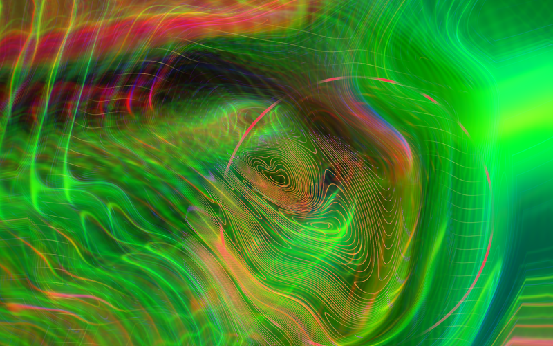
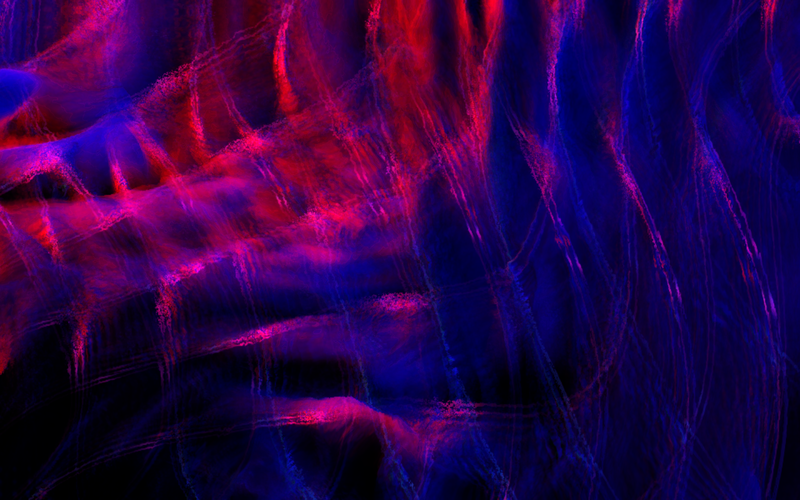
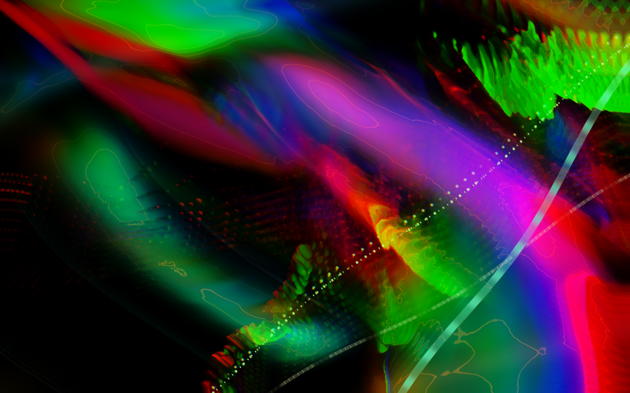
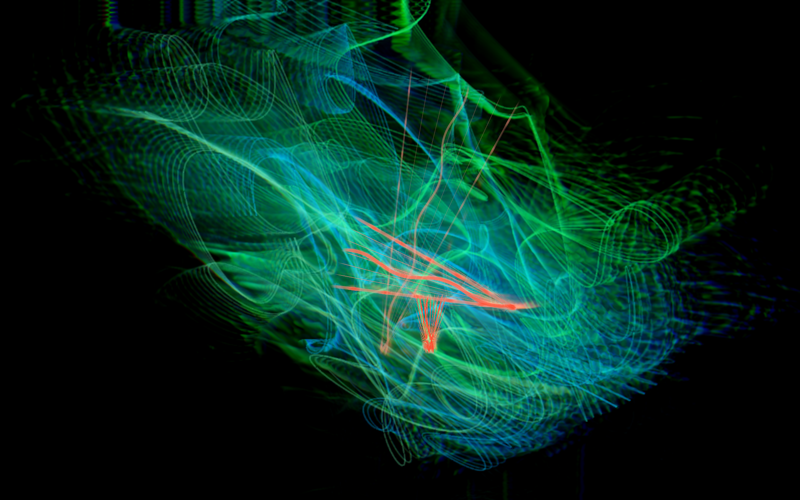
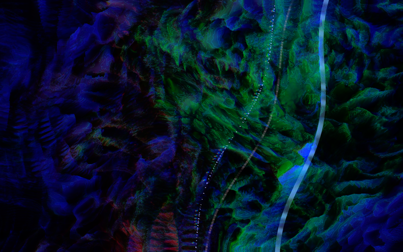
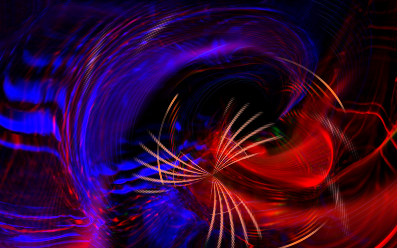

# AudioImage

A C++ audio and video feedback instrument.

[Download AudioImage for macOS (Apple Silicon)](https://github.com/maetyu-d/audio_image_viz/releases/latest/download/AudioImage-macOS.zip),
unzip it, and open **AudioImage.app**. From a built source checkout, use
**Launch AudioImage.command**.

It starts fullscreen, with an evolving image and its internal 128 BPM procedural
techno soundtrack.

**Press C to reveal or hide the controls.** Nothing is overlaid on the image
until you reveal that panel. The compact panel keeps direct **1–6 mode
buttons**, audio source, transport, volume and all eight visual sliders
together. **More** switches to meters, shortcuts, fullscreen and snapshot
actions; **Patch** returns to the sliders without changing the panel size. Hover
a control for a short hint. The image keeps moving while you adjust it.

## Screenshots

**Mode 1**



**Mode 2**



**Mode 3**



**Mode 4**



**Mode 5**



**Mode 6**



## Audio

Drop a **WAV, MP3, FLAC, OGG, M4A, or AIFF** onto the image, or press C and
choose **File**. AAC and CAF also work on macOS. Files stream from disk and
loop; the audio worker keeps the sound running during heavy visuals and while
the file picker is open. Cancelling the picker or selecting a file that fails
initial validation preserves the current track. Loading a new file starts
playback, including when the previous track was paused; mute and volume remain
as set. Choose **Synth** to return to the internal procedural techno.

Files are resampled to the instrument's 48 kHz audio clock, preserving their
original pitch and playback speed; no sample-rate setting is needed.

For a YouTube playlist, press **C → YouTube**, paste its link and choose
**Play**. Watch-page links containing `list=` and YouTube Music playlist links
also work. The queue plays in playlist order, prepares the next track in the
background, skips unavailable entries and repeats the playlist after the last
track. Use **< / >** beside Pause, or **, / .**, for the previous/next track.
**Y** opens the playlist link dialog again. The current track and queue position
appear in the compact panel; **More** shows the playlist title and any loading
error. Switching to **Synth** or **Live**, or successfully loading a file, leaves
the playlist. The C-key panel stays hidden until requested.

For a public Spotify playlist, press **C → Spotify** (or **P**), paste an
`open.spotify.com/playlist/...` link and choose **Play**. Spotify playlist URIs,
localised share links and embed links also work. This imports the publicly
listed track order and **plays matching YouTube recordings**, feeding their
actual audio into the visualiser. It does not stream Spotify audio or require a
Spotify login. The dialog and playback status identify the audio source;
recording versions can differ. **More → Audio** opens the matched YouTube video,
and clicking the playlist title opens its original source.

Matching checks song title, artist, duration and recording version, favouring
artist Topic channels. Unmatched or unavailable entries are skipped; next,
previous, background preparation, pause, volume and repeating work as for a
YouTube playlist. Public listings can be incomplete; the app flags listings of
100 or more entries as potentially partial. Private playlists, local Spotify
files and podcast episodes cannot be imported. Public page changes or regional
availability can affect import and matching.

YouTube audio feeds the same native 48 kHz playback and analyser as local files.
Audio is prepared in a temporary cache, with one following track prepared ahead;
the picture and current audio keep running while the network is busy. Internet
access and a public or unlisted playlist are required. Private, age-restricted,
region-blocked, live and sign-in-only entries may be unavailable; the app does
not read browser cookies or sign into YouTube. Tracks need a compatible M4A
audio stream. The macOS app includes its
[yt-dlp](https://github.com/yt-dlp/yt-dlp) and
[QuickJS](https://github.com/quickjs-ng/quickjs) helpers, so no separate install is
needed. Their licences and pinned versions are included inside the app.

Choose **Live**, or press **I**, to analyse the default macOS audio input. macOS
may ask for microphone access on first use. Select your microphone, interface,
or an installed loopback device in macOS Sound settings. Live input is analysed
without speaker monitoring or recording. To visualise another app's audio, route
it through an available loopback input; the visualiser does not automatically
capture other applications. **D** returns to the internal synth.

The analyser processes every incoming sample at 48 kHz in fixed 512-sample hops,
independently of the video frame rate. A 4096-sample Hann FFT resolves bass and
harmonics; a separate 1024-sample FFT tracks fast low/mid/high attacks. Each
attack detector uses an adaptive threshold and its own recovery time. Short
percussion hits survive slow video frames instead of falling between analysis
snapshots.

Seven bands cover **20–60, 60–160, 160–400, 400–1200, 1200–3500, 3500–9000, and
9000–20000 Hz**. They shape breathing, warp, colour, filaments and caustics;
low, middle and high attacks have separate visual accents. The analyser produces
a 256-column logarithmic spectrum that integrates all FFT bins within each
column. The **More** panel groups these columns into a compact display with peak
markers, seven band meters, measured RMS in dBFS, stereo width and an estimated
pulse rate when a regular pattern is present. Pulse estimation covers roughly
55–200 BPM; complex music can still have ambiguous beat subdivisions.

Automatic analysis gain brings quiet music into useful range, while soft
compression preserves changes in loud passages. This gain never changes playback
volume. A noise gate avoids lifting very low background hiss, and a DC blocker
rejects constant input offsets. Stereo power is measured without summing away
opposite-phase material. The scope uses a triggered trace of contiguous samples,
with separate stereo balance, width and correlation measurements. Live input
requests stereo, falling back to mono if the device cannot provide it.

Source changes reset the analyser's history, envelopes and tempo; the video
feedback keeps flowing. Pausing file/synth playback holds the analysis clock.
Live analysis continues while its picture is paused. Silence leaves ambient
video synthesis running. Muting preserves analysis and animation; volume
controls affect speaker playback, not live input. Input samples are never saved
to disk.

## Image

Each mode has its own geometry, palette, motion and feedback behaviour.

**Mode 1** — rainbow liquid sheets, curling displacement, woven filaments and
floating colour returns. The feedback circuit releases broad, neutral light to
preserve coloured folds during sustained audio. Broken pressure crests follow
the moving liquid contours.

**Mode 2** — hollow signal conduits formed from three crossing banks of paired
voltage contours. The returning image bends their phase and colours their broken
edges. Transparent crossings, delayed overprints and contour-following pigment
drag stretch the traces into torn ribbons and luminous membranes. Bass buckles
the video memory; percussion sends bright packets and fine detail along the
conduits. A free-running voltage sustains the image in silence.

**Mode 3** — transformed video returns with moving luminance keys, channel
exchange and regenerative edges. A small oscillator grows into overlapping
colour layers. Bass widens its pulses and shears the returning image; percussion
injects diagonal signal strips that recur in later generations.

**Mode 4** — stereo samples drive four projected XY beam paths through a moving
oscillator field. The strokes stretch into twisting phosphor filaments and meet
older returns. Dark spaces separate the bright cores. Bass buckles the traces;
percussion splinters them into needle fans, forked strokes and coral/cyan
bursts.

**Mode 5** — two video oscillators modulate each other's phase while the returned
image drives both carriers. Split colour returns and difference-signal
regeneration form unstable interference membranes. Bass bends the feedback
coordinates; percussion resets the phase in sharp, folded strips. Selective
decay preserves bright fringes and dark gaps.

**Mode 6** — opposing spiral flows fold and subtract successive generations of
the image around a moving dark opening. Bass twists and stretches the return;
percussion ejects crescents, shards and fine blue/orange needles. Edge light
reveals the recursive folds and their changing depth.

Bass and percussion take a different form in each mode. Bloom, colour separation
and finishing also vary. The liquid contour overlay belongs to Mode 1.

The image is a real recirculating video signal: two half-float framebuffers feed
back into each other through rotation, expansion, nonlinear displacement,
mirrored coordinates, chromatic separation, and channel cross-modulation. Four
additional image memories produce delayed returns of roughly one second.
Luminance keying mixes these older images into the current. Source oscillators
continue injecting new shapes; controlled saturation prevents feedback from
settling into white. Native-resolution contours and a separate bloom pass finish
the image. No camera or video file is required.

**Bass bends the feedback itself.** Sustained bass drives strong nonlinear
circulation and broad source warps. Changes in bass and sub-bass produce elastic
twisting and unequal stretching across the image, while individual low attacks
send travelling pressure fronts through the recirculating colour. Attack and
release envelopes keep the deformation connected to the actual audio.

**Percussion injects sharp colour and fine detail.** Low hits open bright
crests, middle-band attacks launch coloured fans and fringes, and treble hits
produce short bursts of needles and tiny beads. Each onset keeps its own audio
timestamp, origin, pigment and expanding front; overlapping hits continue
independently. They fade before their history slots are reused, including during
fast percussion. Coloured ink enters the feedback memory, and a second treatment
resolves crisp edges at the display's native resolution after bloom and tone
mapping. Saturated accents remain visible over bright feedback and leave softer
trails behind them.

**Auto** morphs between modes every 48 seconds and generates new phase fields
every 96 seconds. Manual mode selection turns Auto off. Mode geometry, feedback
motion, colour and finishing blend over three seconds. During the blend, memory
briefly releases faster so sparse modes can emerge from dense ones. Mutations
blend over nine seconds without clearing the existing feedback. Eight sliders
control feedback, time smear, warp, symmetry, colour phase, detail, audio
reaction and exposure. Drag or scroll a slider; right-click it to restore its
default. Hold Shift while dragging, scrolling or using the tuning keys for
smaller adjustments. **Reset** restores all eight visual sliders, and **Clear**
empties the feedback memory. **Reaction** starts at 82% and controls
audio-driven deformation, percussion, colour and beam traces. Zero disables new
audio influence; existing feedback decays naturally.

## Keys

| Key | Action |
| --- | --- |
| C | Show/hide controls; hidden at launch |
| Space | Pause/resume picture and file/synth transport |
| F | Toggle fullscreen/windowed |
| 1–6 / Left / Right | Select mode |
| A | Toggle automatic mode changes |
| R | Generate new phase fields |
| Backspace | Clear feedback memory |
| I / D | Live input / internal synth |
| Y | Open a YouTube playlist |
| P | Import a public Spotify playlist using matched YouTube audio |
| , / . | Previous / next playlist track |
| M | Mute/unmute playback |
| - / = | Lower/raise playback volume |
| S | Save a clean PNG, without the controls |
| Tab / Shift+Tab | Select slider while controls are open |
| [ / ] | Adjust selected slider while controls are open |
| Escape | Close controls, then quit |
| Cmd+Q | Quit |

Snapshots are saved in **AudioImage captures** beside the app. Live input
analysis continues while the picture is paused; live audio is never recorded.

## Build and checks

The project includes its music engine, world generator, phase shader, fonts and
vendored raylib source. It builds independently of other projects. The packaged
app contains everything it needs at runtime. Third-party licences are preserved
in the source tree and bundled resources.

On macOS, install the Xcode Command Line Tools, CMake and Python 3. From a fresh
checkout, fetch the pinned playback helpers before configuring:

```sh
python3 scripts/fetch_youtube_tools.py
cmake -S . -B build -DCMAKE_BUILD_TYPE=Release
cmake --build build -j 4
ctest --test-dir build --output-on-failure
```

The helper downloader verifies yt-dlp's published checksum, combines the QuickJS
macOS architectures and preserves the upstream licences. Downloaded helper
executables, app bundles, local captures and build products are excluded from
Git. The macOS release ZIP includes the runtime helpers and fonts.

Run the built executable with `--help` for command-line options. Useful
examples:

```sh
"build/AudioImage.app/Contents/MacOS/AudioImage" --windowed
"build/AudioImage.app/Contents/MacOS/AudioImage" --file /path/to/music.wav
"build/AudioImage.app/Contents/MacOS/AudioImage" --youtube 'https://www.youtube.com/playlist?list=PLAYLIST_ID'
"build/AudioImage.app/Contents/MacOS/AudioImage" --spotify 'https://open.spotify.com/playlist/3cEYpjA9oz9GiPac4AsH4n'
"build/AudioImage.app/Contents/MacOS/AudioImage" --self-check --hidden --seed 77
"build/AudioImage.app/Contents/MacOS/AudioImage" --offline-audio --hidden --frames 240 --seed 77 --screenshot preview.png
```

`--no-audio` avoids opening an audio device and runs ambient visuals.
`--offline-audio` feeds actual synth samples into the analyser without playing
them, for deterministic rendering. `--seek N` pre-rolls the picture using that
silent synth before starting the selected audio. `--quality N` sets the maximum
feedback height (default 900, range 300–2160); the finishing pass uses the
display's native framebuffer. `--controls` opens the console for debugging;
normal launches always keep it hidden. Hidden windows require a finite frame
count.

The analysis tests verify seven-band frequency isolation, calibrated RMS, high
harmonics between display centres, antiphase stereo, width and balance, DC
rejection, quiet-input gain, silence and low hiss. They exercise 12 ms
percussion, equivalent results at 12/60/144 Hz video and different callback
sizes, 90/120/128/174 BPM pulse fixtures, source resets, malformed samples,
overruns and concurrent ring wraparound. An additional regression test extracts
the main pulse from sixteen seconds of the actual layered synth soundtrack
across three seeds, rather than checking only isolated click tracks. The
separate `audio_playback_tests` executable accepts continuous-tone fixtures and
checks playback with the graphics loop stalled, short loops, pause/resume, muted
analysis, file replacement and switching back to the synth. It uses a real audio
device with speaker output muted, so it is run separately from CTest. It also
verifies end-of-track completion without repeating, which the YouTube queue uses
for automatic advance. The device-free `youtube_queue` test covers URL
validation, metadata, queue order, unavailable entries, cache paths,
cancellation and source replacement. `youtube_audio_tests TOOLS CACHE URL` is a
separate network/audio-device check that plays and analyses two real playlist
tracks with speaker output muted. It accepts either a YouTube or public Spotify
playlist link and prints each recording's actual YouTube source. The
`spotify_queue` regression covers public-link validation, Spotify metadata,
duplicate entries, potentially partial lists, recording matching, skipped
tracks, navigation, provider switching, cache attribution and cancellation. The
public [Spotify Web API Testing
playlist](https://open.spotify.com/playlist/3cEYpjA9oz9GiPac4AsH4n) is a small
live integration fixture:

```sh
build/youtube_audio_tests vendor/youtube build/spotify-live-cache 'https://open.spotify.com/playlist/3cEYpjA9oz9GiPac4AsH4n'
```

The sample-rate check generates 38 one-second tone files across WAV, FLAC, AIFF,
OGG, MP3 and M4A, covering 8, 11.025, 16, 22.05, 24, 32, 44.1, 48, 88.2, 96,
176.4 and 192 kHz where the codec supports them. It measures output pitch on
both channels, source duration, the 48 kHz analysis clock, playback speed,
pause/resume and loop continuity. FFmpeg is needed only to generate these test
fixtures:

```sh
cmake --build build --target audio_sample_rate_tests -j 2
python3 tests/audio_sample_rates.py build/audio_sample_rate_tests build/sample-rate-fixtures
```

The renderer check exercises all six modes, audio-driven animation, framebuffer
resizing, brightness/colour range, and motion between frames. Microphone
permission and the user's selected hardware must be checked interactively.

The separate native OpenGL check compares identical silent and audio-driven
modes, measures broad bass displacement and percussion colour/detail, and checks
that setting **Reaction** to zero produces the same image as silence:

```sh
build/reaction_render_tests captures/reaction
```

It writes paired PNGs for visual inspection. The analyser regression also checks
that onset timestamps and strengths match at different video frame rates.

The mode identity check renders all six instruments with the same seed and
musical fixture, compares both colour and luminance-normalised spatial
structure, and verifies that a live transition can recover Mode 4's dark space:

```sh
build/scene_render_tests captures/modes
```

It writes six mode previews and a live transition preview for visual inspection.

The feedback signal check compares all six modes with their memory cleared every
frame, checks bass/percussion response, follows twelve seconds of synthesis for
clipping or a static result, and exercises transitions between modes. It also
renders thirty seconds of the actual soundtrack with multiple seeds and 30/60 Hz
video, rejecting excessive neutral white or loss of the picture:

```sh
build/memory_render_tests captures/video-memory
```

The saved comparisons show the oscillator stimulus separately from the image
created by recirculation.

A compact visual review captures every mode in silence and at the initial
attack, two, six and twelve seconds of the same analysed synth performance:

```sh
build/video_review captures/visual-review
```

These snapshots complement the quantitative checks with comparisons of colour,
contrast, depth and detail at different stages of feedback accumulation.

To focus the memory, audio and sustained soundtrack checks on one mode, add
`--scene N`, where N is 1–6. For example, to check Mode 2:

```sh
build/memory_render_tests captures/mode-2 --scene 2
build/reaction_render_tests captures/mode-2-reaction --scene 2
```

Mode 2 generates its signal contours with three analytic phase fields at the
same feedback resolution as the other modes. The returning image supplies their
texture, colour and broken structure.

The macOS rendering benchmark warms the shaders and image memory, then times
GPU-complete batches using a fixed soundtrack, seed, output size and quality. It
excludes shader compilation, audio-device startup, screenshots and vsync:

```sh
build/video_benchmark captures/mode-2-performance.json 2 900
```

The reported frame times describe rendering throughput; interactive presentation
and other applications' GPU activity can also affect playback smoothness.
